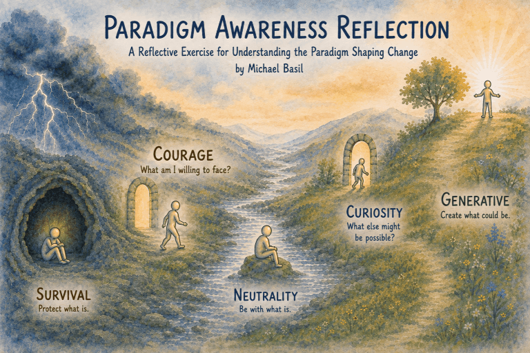

# Paradigm Awareness Reflection  

*A Reflective Exercise for Understanding the Paradigm Shaping Change by* **Michael Basil**

This exercise helps you notice the paradigm from which a person, group, or organization is responding to a situation, particularly when uncertainty, disruption, conflict, or change is present.

In difficult situations, people can become organized around protecting what they know, what they have, or how they see themselves. When this happens, conversations can become constrained by a survival paradigm even when people consciously want to change.

Within Circle3, this reflection primarily supports [Integrate the Conversation](/moves/integrate/){: data-ga-event="learn_more" data-ga-label="lenses_paradigm_to_moves_integrate"} by helping facilitators notice when protective responses may narrow what people can hear or consider. It also invites reflection on movement toward neutrality, curiosity, and new possibilities.

## Framing

The framing below explores three paradigms through which people may experience, interpret, and respond to a situation.

These paradigms are fluid orientations shaped by circumstances, relationships, and experience, rather than fixed characteristics of a person.

### Three paradigms

**Survival**

The primary orientation is protection.

Survival can show up as fear, shame, anger, pride, defensiveness, control, withdrawal, blame, or the need to be right.

The underlying orientation is: **Protect what is.**

**Neutrality**

The primary orientation is openness.

Neutrality creates space to observe what is happening without needing to defend a particular position, identity, or outcome.

The underlying orientation is: **Be with what is.**

**Generative**

The primary orientation is possibility.

From a generative paradigm, attention moves beyond protecting or simply responding to what already exists and toward exploring what could become possible.

The underlying orientation is: **Create what could be.**

### The thresholds

The movement between paradigms is often as important as the paradigms themselves.

**Survival → Neutrality**

The threshold is **Courage**.

Courage is the willingness to face what is here without immediately moving back into protection.

*What am I willing to face?*

**Neutrality → Generative**

The threshold is **Curiosity**.

Curiosity opens attention toward what might be possible rather than remaining focused only on what is already known.

*What else might be possible?*

This movement toward a generative paradigm creates the opening for new possibility—and for turning that possibility into aligned commitments through [Reconcile the Intention](/moves/reconcile/){: data-ga-event="learn_more" data-ga-label="lenses_paradigm_to_moves_reconcile"}.

## The exercise

Take a moment to settle your attention before beginning.

Use a short mindfulness practice, such as following the breath, feeling the body, or sitting in quiet awareness, to help you slow down and become present.

* Suggested exercise: [One Breath](https://www.youtube.com/watch?v=3zv9kQA-wfE&t=5s){: data-ga-event="external_link" data-ga-label="lenses_paradigm_one_breath"}

Let your attention shift from immediate thinking into memory.

Engage the following prompts from that state of awareness.

### 1. What situation are you reflecting on?

Bring a specific person, group, interaction, or change situation clearly into mind.

What is happening?

What feels difficult, stuck, unresolved, or full of possibility?

### 2. What paradigm appears to be operating?

As you reflect on the situation, what do you notice?

**Survival** — protection, fear, anger, pride, defensiveness, control, withdrawal, blame, or preservation.

**Neutrality** — an ability to stay present with what is happening without needing to defend, fix, control, or resolve it.

**Generative** — openness to possibility, imagination, creation, or something that does not yet exist.

What paradigm seems most present?

### 3. What is this paradigm revealing?

**If survival is present:**

What might this person, group, or organization be protecting?

What feels threatened?

What identity, assumption, position, relationship, resource, or way of working might be difficult to let go of?

What might be difficult to acknowledge?

**If neutrality is present:**

What is this person, group, or organization able to stay present with, without needing to defend, fix, control, or resolve it?

What curiosity might already be quietly present?

What might they be noticing now that wasn't visible before?

**If generative is present:**

What new possibilities are becoming visible?

Which assumptions may be loosening?

What might become possible if the group explores this direction?

## Reflection

As you look across your responses, this reflection is pointing toward a working hypothesis about the paradigm shaping this situation.

You may begin to notice that what feels like resistance, conflict, or difficulty moving forward can sometimes reflect a survival paradigm protecting something that feels important. Naming that can bring clarity, even before anything about the situation changes.

This reflection is not a judgment of where a person or group is. Paradigms can shift depending on the situation, relationships, and conditions around them.

Take a moment to notice:

- what appears to be protected
- where neutrality or curiosity may already be present
- and how this paradigm may be shaping the situation

## Sharing

Reciprocal reflection helps reveal where survival paradigms may be operating, where neutrality or curiosity may be present, and where different paradigms coexist.

If you choose to share your reflection, you might begin with:

*Would you be open to exploring what might be shaping our response to this situation?*

Invite the other person, group, or team to complete the same reflection from their side.

## Continue exploring

If you’d like to go further with this work or explore additional dimensions, you’re welcome to connect.

👉 [Let’s connect](/contact/){: data-ga-event="contact_click" data-ga-label="lenses_paradigm_to_connect"}
