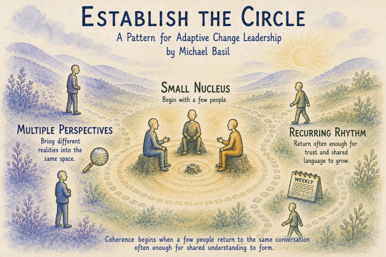

# Establish the Circle

*A Pattern for Adaptive Change Leadership by* **Michael Basil**

*For leaders, facilitators, or change agents when people care about the change, but can’t connect, align, or move together.*

## Summary

Create a small, recurring Circle where people with different perspectives reason together about a change initiative. Guided by an integrative facilitator, the group connects isolated champions, develops shared understanding, and builds momentum for coordinated action.

## Story

Alex was passionate about a change that crossed several teams. The more Alex tried to move it forward, the further away it seemed. Meetings kept happening, people expressed interest, but nothing was taking hold.

Alex began to wonder whether people were even seeing the same situation.

Rather than propose another plan, Alex invited a few people with different perspectives to try an experiment: four weekly conversations around a shared intention, without deciding the solution in advance.

The first gathering was difficult. One person questioned the premise. Another described constraints Alex hadn't understood. Alex felt the urge to defend the change but instead listened and asked what others were seeing.

The conversations didn't immediately get easier. More tensions surfaced. But people began connecting obstacles that had previously seemed unrelated.

"Oh, that explains why your team couldn't move."

After four sessions, the group hadn't resolved everything. But they had developed a clearer understanding of what was blocking progress—and wanted to continue.

For the first time, the change Alex had imagined felt less like a distant possibility and more like something taking shape among them.

## Context

You are leading change that crosses roles, teams, or areas of expertise and requires people with different perspectives to develop enough shared understanding to move together.

## Problem

Change requires people across teams and levels of authority to work together, but they see different parts of the situation without understanding how those parts connect. Potential champions remain isolated, important constraints go unseen, and competing initiatives pull attention in different directions. People stay busy, yet struggle to develop enough shared understanding to move change forward.

## Forces

### Hierarchy vs. Experience

Decision makers hold formal authority high in the structure, while those experiencing the change operate deeper in the organization. Decisions can therefore be made without the full benefit of the experience of those doing the work, while practitioners may lack the authority to act on what they see.

### Coordination vs. Attention Scarcity

The organization needs coordinated change, but people’s attention is already fragmented across many initiatives, producing activity that's locally useful but poorly coordinated with the larger system.

### Expertise vs. Integration

Different subject matter experts understand different parts of the system, but their perspectives can remain separated within their domains. Each perspective may be locally valid while the combined picture remains fragmented, making it hard to see how the parts fit together.

### Action vs. Reflection

Organizations reward visible action and execution, while meaningful change often requires time to reflect, make sense of experience, and integrate what has been learned. Pressure to demonstrate progress can therefore crowd out the reflection needed for coherent action.

## Solution

**Establish the Circle.**

Create a small, recurring conversational nucleus where people with different perspectives can reason together long enough for shared understanding and coordinated momentum to form.

**Do this by:**

- Form a **three-person nucleus** with at least two subject matter perspectives plus facilitation capability.
  - Mechanism: diversity of perspective plus a small, trusted space prevents early groupthink and allows tensions to surface safely.
  - Effect: the group can see the same initiative from multiple realities without fragmenting.
- Include an **integrative facilitator** who can move the room between grounding and expanding, inquiry and action, and listening and integration.
  - Mechanism: active facilitation converts scattered observations into usable shared meaning.
  - Effect: conversations become progressively more coherent instead of cyclical or performative.
- Meet **weekly at a consistent time** and keep the core intentionally small (three to seven regular participants).
  - Mechanism: cadence builds relational memory; small size preserves candor, accountability, and depth.
  - Effect: shared language and trust accumulate fast enough to influence live change decisions.
- Involve sponsors lightly at first and invite additional participants selectively when learning or progress requires it.
  - Mechanism: visible sponsorship provides legitimacy while selective participation protects conversational quality.
  - Effect: insights can spread outward without collapsing the core space.

A bounded experiment can lower the barrier to starting: try four weekly conversations, then decide together whether the Circle should continue, adapt, or conclude.

Use this move as an operating container, not a status forum. When drift appears, use the Failure Modes below as a diagnostic and coaching aid.

## Resulting Context

When this move takes hold, people who once saw disconnected parts of the change begin to understand how their perspectives and constraints fit together.

Potential champions connect, shared language develops, and impediments surface early enough to influence decisions. The Circle becomes a center from which coordinated action and durable commitments can emerge.

As circumstances change, the Circle may continue as a small recurring group, evolve into a broader coalition or community of practice, or adjourn when its purpose has been fulfilled.

## Known Uses

### Enterprise technology transformation

Circles played an instrumental role in unlocking major technology changes that had stalled through conventional approaches. In a global education technology organization, recurring conversations across continents helped engineers and operations teams surface impediments and develop shared understanding, contributing to an observability transformation that reduced multi-team investigations from days to minutes.

In a large enterprise software business, cloud migration efforts had stalled repeatedly over several years. Circles brought architects, engineers, and managers into sustained conversation, allowing them to identify impediments and build a shared center of gravity for action. This was instrumental in unlocking the transition to Kubernetes and GitOps, creating business agility that helped the business protect its established market share and compete in new markets.

### Transformation Dojo and InnerSource communities

Instructor-led training alone was not translating into the adoption of new practices. Circles connected practitioners and change champions who already understood parts of the problem but lacked a shared place to work through it. Participants began co-authoring—and sometimes leading—the development of learning journeys grounded in their actual organizational conditions. These communities helped drive the mindset and capability shifts needed for broader technical and organizational transformation.

### Community governance

In a residential community facing longstanding disputes and guarded relationships, Circles opened dialogue among board members and people affected by governance decisions. These conversations helped resolve multi-year conflicts, substantially improve budgeting, and create opportunities for residents to influence the policies and decisions shaping their community. The shift was from adversarial, procedural governance toward greater shared understanding and participation.

## Key Characteristics

- Begins with a three-person nucleus.
- Brings together at least two relevant perspectives.
- Includes integrative facilitation.
- Meets weekly with a small, consistent core.
- Reasons together about a shared intention rather than reporting status.
- Invites additional perspectives as needed without losing the core.
- Begins informally and can evolve or adjourn as circumstances change.

## Failure Modes

### No One Shows Up

*Description*: Few people engage; the intention may not feel worthwhile, participation may feel risky, or competing demands take priority.

*Mitigation*: Ask prospective participants what would make the Circle worthwhile, sharpen the intention, and offer a bounded experiment; if interest remains absent, reconsider the Circle's timing or fit.

### The Circle Becomes a Status Meeting

*Description*: Conversations focus on reporting progress rather than reasoning together, turning reflection into routine updates.  

*Mitigation*: Refocus on inquiry and sense-making; the facilitator guides participants to explore tensions and perspectives, not just report status.

### Dominance by Authority

*Description*: Senior leaders or sponsors overpower discussion, reducing psychological safety and stifling honest dialogue.

*Mitigation*: Ensure leaders participate lightly; the facilitator actively creates space for all voices.

### Lack of Facilitation

*Description*: Without a skilled integrative facilitator, discussions drift, become unfocused, or are dominated by the loudest voices.

*Mitigation*: Include an experienced facilitator to guide conversation, surface tensions, and help the group move between reflection and action.

### Excessive Growth

*Description*: Too many participants dilute intimacy, making conversations shift toward presentation rather than exploration.

*Mitigation*: Keep the core group small (3–7 people) and invite others selectively when their perspectives are needed.

### Isolation from the Organization

*Description*: If the Circle becomes disconnected from the broader system, insights fail to spread and the Circle loses its coherence role.

*Mitigation*: Encourage participants to share insights outside the Circle and connect with relevant stakeholders.

### Premature Formalization

*Description*: Rapid institutionalization can squash openness, turning the Circle into a rigid governance body.

*Mitigation*: Maintain informality initially; allow the Circle to evolve naturally before codifying structures.

### Overstaying Its Welcome

*Description*: Continuing the Circle after its purpose is fulfilled can drain energy, create redundancy, and stifle emergent structures.

*Mitigation*: Periodically review the Circle’s relevance; adjourn, evolve, or spin off new groups when the original goal has been achieved.

## Related Patterns

- [Integrate the Conversation](/moves/integrate/){: data-ga-event="learn_more" data-ga-label="establish_to_integrate"} – When differing perspectives or tension begin to stall the Circle, integrative facilitation helps participants work through them.
- [Reconcile the Intention](/moves/reconcile/){: data-ga-event="learn_more" data-ga-label="establish_to_reconcile"} – When emerging understanding needs to guide decisions beyond the Circle, reconciling a visible intention helps carry it forward.

### [Fearless Change Patterns](https://fearlesschangepatterns.com){: data-ga-event="external_link" data-ga-label="establish_to_fearless_change"}

These patterns can help when a Circle needs willing participants and a manageable way to begin.

- *Ask For Help*: When a small nucleus lacks needed perspectives or support, invite someone to contribute.
- *Study Group*: When people need a low-pressure way to begin learning together, gather around a shared question.
- *Go-To Person*: When an obstacle calls for knowledge or influence beyond the nucleus, connect with someone who can help unblock it.
- *Future Commitment*: When people hesitate to join an open-ended effort, invite a specific next commitment.

## Explore in Your Context

This pattern becomes meaningful when applied in your own change effort, not just understood conceptually.

If it resonates with your work, consider:

- Where are people interpreting the same change differently?
- Which champions are isolated and could benefit from a shared space?
- What small step could help you start a Circle of your own?

If you’d like to deepen this work:

- Unpacking this further
- Sharing a similar method
- Starting a Circle

👉 [Let’s connect](/contact/){: data-ga-event="contact_click" data-ga-label="establish_to_connect"}
