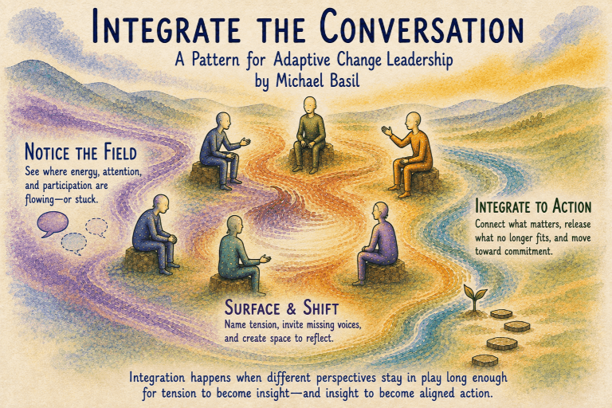

# Integrate the Conversation

*A Pattern for Adaptive Change Leadership by* **Michael Basil**

*For facilitators, team leads, or change agents when people want progress, but conversations are stuck or going in circles.*

## Summary

Guide a conversation when people are talking past one another, caught in unproductive patterns, or unable to work through differences. An integrative facilitator notices participation and energy, makes room for missing perspectives, and helps the group develop shared insight, clearer choices, and coordinated action.

This Move works within a Circle or in other change conversations.

## Story

Alex was shepherding a change that refused to move forward. Meetings produced plenty of discussion, but little progress. Some people pushed for decisions, others raised complications, and a few had grown quiet.

During one conversation, Alex had a nagging, gut-level sense that something wasn't right. The room felt unsettled and distracted, yet the discussion kept moving as though nothing were wrong.

Instead of pushing the agenda forward, Alex interrupted the pattern.

"Let's check in for a moment. I'm curious how this conversation is landing for everyone."

At first, nobody answered. Someone said, "I think we're fine," but Alex let the silence remain.

Eventually, one participant acknowledged feeling rushed toward a decision. Another raised a dependency that hadn't been understood. Alex invited the first person to choose whose perspective the group might hear next.

As the conversation moved around the room, attention returned. The group hadn't reached a decision. But with the tension finally named, they could begin working through it together.

## Context

You are facilitating a change conversation involving multiple perspectives, roles, priorities, and forms of expertise that need to contribute to shared understanding and coordinated action.

## Problem

People enter a conversation with different experiences, priorities, and interpretations, but struggle to make sense of them together. Some push for decisions while others withdraw, leaving important tensions unspoken. Discussion continues, yet the group cannot turn its differing perspectives into coordinated action.

## Forces

### Speaking vs. Listening

Some participants dominate the conversation while others hold back. More speaking can increase expression without increasing understanding, while too little participation leaves important perspectives unheard, making integration difficult.

### Speed vs. Reflection

The group pushes toward decisions before perspectives are integrated, or reflects without moving forward. Pressure for visible progress can make reflection feel like delay, while insufficient reflection can lead the group to act before it understands what it is seeing.

### Control vs. Emergence

Attempts to direct the conversation can restrict insight and participation, while too little direction allows the conversation to drift. The facilitator must provide enough structure to maintain coherence without controlling what the group discovers.

### Divergence vs. Convergence

Ideas can expand faster than the group can connect and prioritize them. Too little divergence limits what the group can see, while too much divergence without convergence leaves ideas fragmented and prevents clear priorities and action from emerging.

## Solution

**Integrate the Conversation.**

Keep multiple perspectives in play and actively work with the tension among them until differences can become shared insight, clearer priorities, and coordinated action.

**Do this by:**

- Observe conversational energy and participation patterns in real time.
  - Mechanism: noticing who is dominating, quiet, or disconnected reveals where information flow is constrained.
  - Effect: the facilitator can intervene with precision instead of reacting globally.
- Apply targeted integration moves: ground abstractions, widen siloed viewpoints, and introduce focus when drift appears.
  - Mechanism: alternating expansion and convergence helps the group hold divergence without losing direction.
  - Effect: ideas become connected, prioritized, and actionable.
- Surface unspoken tension through an appropriate intervention, such as a check-in, affect labeling, or deliberate silence.
  - Mechanism: checking how the conversation is landing, naming a tension tentatively, or allowing silence can create reflective space without imposing an interpretation.
  - Effect: concerns that were shaping the interaction become discussable, restoring attention that the group can use.
- When the group is ready, help participants release outdated assumptions or priorities and identify next steps or commitments.
  - Mechanism: deliberate closure prevents legacy positions from silently governing decisions.
  - Effect: the group can move forward with clearer commitments and less hidden friction.

These shifts require practice and ongoing calibration. When the conversation begins to degrade, use Failure Modes as an in-session diagnostic and coaching reference.

## Resulting Context

When this move takes hold, perspectives and tensions that previously fragmented the conversation become visible and workable.

Participants can hear one another more fully, examine differences without rushing toward agreement, and develop shared understanding of what is happening. As attention and participation improve, the group can make clearer decisions and coordinate action.

Over time, the group becomes better able to work through tensions and adapt as circumstances change.

## Known Uses

### Enterprise transformation and platform engineering

In cross-functional technology change, architects, engineers, managers, and delivery teams often interpreted the same impediments differently. Integrative facilitation interrupted unproductive exchanges, surfaced tensions and missing perspectives, and helped groups focus on what was actually blocking progress. This was instrumental in unlocking modernization and cloud operations changes that had stalled despite repeated planning efforts. The missing ingredient was often not another technical plan, but integrating what different people knew.

### Transformation Dojo and InnerSource communities

Circle conversations worked with the obstacles participants brought from their own departments, rather than simply delivering a fixed curriculum. Facilitators alternated between listening, challenging assumptions, inviting quieter perspectives, and bringing attention back to a shared concern. This helped practitioners translate Agile, InnerSource, and technical learning into changes they could adopt and lead in their own environments, contributing to wider shifts in mindset and capability.

### Community governance

In residential governance settings, long-running disputes had left people guarded and conversations polarized. Integrative dialogue created opportunities to name tensions, hear from residents affected by decisions, and move beyond entrenched positions. This helped restore relationships and make progress on issues—including budgets and unresolved disputes—that formal proceedings alone had not settled.

## Key Characteristics

- Attends to participation, attention, and tension as well as conversational content.
- Makes room for missing or quieter perspectives.
- Shifts between inquiry and focus as the group needs.
- Works with tension without forcing agreement or allowing the conversation to drift.
- Supports clearer decisions and commitments when the group is ready.

## Failure Modes

### Over-Pressing

*Description*: Pushing too hard to force integration leads to resistance or withdrawal.  

*Mitigation*: Pause, observe, and gently guide energy shifts.

### Over-Loosening

*Description*: Allowing fragmentation to persist can stall decisions or diffuse accountability.  

*Mitigation*: Introduce structure or focus when appropriate.

### Personalization of Conflict

*Description*: Tensions escalate into personal disputes.  

*Mitigation*: Reframe conflicts around ideas, deepen understanding, and coach individuals directly when needed.

### Avoiding Commitment

*Description*: Participants hesitate to make decisions or articulate priorities.  

*Mitigation*: Facilitate small, low-risk commitments to build confidence.

### Ignoring Field Dynamics

*Description*: Failure to read group patterns causes interventions to miss the mark.  

*Mitigation*: Continuously observe, reflect, and adjust facilitation.

## Practice Influence

Chris Voss and the Black Swan Group's work on labeling and dynamic silence, as presented in [Negotiation 9®](https://www.blackswanltd.com/newsletter/what-is-the-black-swan-groups-negotiation-9-n9), influenced the author's approach to navigating tension and creating space for understanding.

## Related Patterns

- [Establish the Circle](/moves/establish/){: data-ga-event="learn_more" data-ga-label="integrate_to_establish"} – When integrative dialogue would benefit from a recurring home, establishing a Circle provides continuity and space for shared understanding to develop.
- [Reconcile the Intention](/moves/reconcile/){: data-ga-event="learn_more" data-ga-label="integrate_to_reconcile"} – When a group needs a shared reference for decisions, reconciliation can carry insights from conversation into an evolving intention.

### [Zen Leadership Patterns](https://zenleader.global){: data-ga-event="external_link" data-ga-label="integrate_to_zen_leadership"}

These patterns offer ways to notice and work with different forms of energy in conversation.

- *Driver*: When discussion needs focus and movement toward a decision.
- *Organizer*: When the group needs structure, clarity, or coordination.
- *Collaborator*: When relationships, participation, or mutual understanding need attention.
- *Visionary*: When the group is stuck in existing assumptions and needs to explore possibilities.

### [Fearless Change Patterns](https://fearlesschangepatterns.com){: data-ga-event="external_link" data-ga-label="integrate_to_fearless_change"}

These patterns offer complementary ways to make participation and reflection possible.

- *Time for Reflection*: When a conversation is moving too quickly to notice what is happening, create space to reflect.
- *Plant the Seeds*: When an idea or perspective isn't ready for direct consideration, introduce it gradually and allow interest to develop.
- *Personal Touch*: When an important perspective remains unheard, engage the person individually to understand what may be preventing participation.
- *Just Do It*: When a small facilitation experiment can help the group move forward, try it rather than waiting for a complete plan.

## Practical Resources

Developing the ability to integrate a conversation requires reflection and practice. These resources offer complementary lenses for noticing how meaning, energy, and paradigm shape what happens in the conversation.

### Sense Making Reflection

Understand how different interpretations of a situation shape coordination, decision-making, and alignment, and where misalignment emerges when people are operating from different sense-making frames.

👉 [Explore](/lenses/sense/){: data-ga-event="learn_more" data-ga-label="integrate_to_lenses_sense"}

### Energy Awareness Reflection

Build awareness of how relational energy is showing up in your conversations, and how your interventions influence attention, tension, and participation.

👉 [Explore](/lenses/energy/){: data-ga-event="learn_more" data-ga-label="integrate_to_lenses_energy"}

### Paradigm Awareness Reflection

Notice when a survival paradigm—protection, defensiveness, withdrawal, or the need to be right—is constraining the conversation, so the group can find the courage and neutrality that make integration possible.

👉 [Explore](/lenses/paradigm/){: data-ga-event="learn_more" data-ga-label="integrate_to_lenses_paradigm"}

## Explore in Your Context

This pattern becomes meaningful when applied in real conversations, not just understood conceptually.

If it resonates with your work, consider:

- Where are conversations becoming fragmented or stuck?
- Which voices or perspectives are dominating, and which are missing?
- What small shift could help restore integration and move the group forward?

If you’d like to deepen this work:

- developing or formalizing a Circle in your organization
- practicing conscious facilitation and conversational micro-moves
- working more intentionally with relational energy in teams and systems

👉 [Let’s connect](/contact/){: data-ga-event="contact_click" data-ga-label="integrate_to_connect"}
