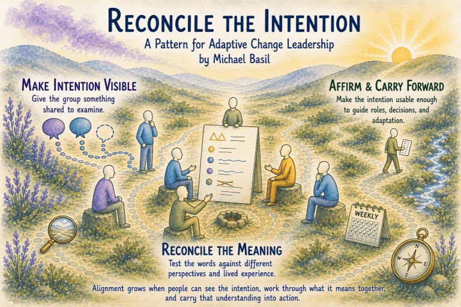

# Reconcile the Intention

*A Pattern for Adaptive Change Leadership by* **Michael Basil**

*For leaders, facilitators, or change agents when a group struggles to act cohesively due to ambiguous priorities, fragmented mental models, or misaligned intentions.*

## Summary

Guide people through recurring conversations around a visible expression of shared intention, such as principles, a charter, or a working agreement. As participants question and test its meaning in practice, they develop shared understanding that can guide decisions across teams and roles. The artifact carries that understanding forward and can evolve as circumstances change.

## Story

Alex was helping lead an initiative involving several teams. Meetings were busy and often appeared productive. Ideas were exchanged, priorities discussed, and people generally left believing they were aligned.

But afterward, progress fragmented. Teams interpreted decisions differently, promising ideas disappeared, and considerable effort produced little movement. Everyone seemed to be rowing, but the boat was going in circles.

Alex brought a draft of the initiative's guiding principles into the next conversation. Instead of asking whether everyone agreed, Alex invited them to challenge what was written.

"Where doesn't this reflect what you're seeing? What would you change?"

The first responses were polite. Then someone questioned a principle others had assumed was settled. Another explained why a commitment wouldn't work in their part of the organization.

People began revising the language together, testing what the words meant in practice. It was no longer a document to approve and set aside. The group was beginning to create a shared center of focus—an intention they could help shape, explain, and use to coordinate their efforts.

## Context

You are leading change where an existing intention—expressed through principles, a charter, a working agreement, or another shared direction—must be interpreted and acted on by multiple participants and stakeholders.

## Problem

A group appears aligned around shared principles or an intention, but people may understand them differently or never fully embrace them. The words are accepted without becoming a meaningful guide for decisions and behavior. As circumstances change, the apparent agreement falls apart and coordinated action fragments.

## Forces

### Iteration vs. Completion

Alignment requires enough iteration to surface ambiguity, test meaning, and refine understanding, while the group also needs enough completion to make the intention usable. Premature completion can create the appearance of agreement while ambiguity remains unresolved; endless iteration can prevent the group from turning understanding into a usable reference.

### Structure vs. Emergence

A formal artifact provides structure, continuity, and a stable reference point, while genuine alignment emerges through conversation and shared sense-making. Too much structure can make the artifact rigid and disconnected from experience; too little structure leaves the conversation without a common reference for working through differences.

### Internal vs. External Alignment

The intention must make sense to the people inside the group while also being understandable and useful to people who interact with or depend on the group. Optimizing only for internal understanding can create confusion at organizational boundaries; optimizing only for external clarity can produce an intention that does not reflect the group’s lived reality.

### Cultural Codification vs. Adaptation

Codifying principles helps preserve and communicate culture and intent, while changing circumstances require those principles to be revisited and adapted. A rigid artifact can become disconnected from reality; an artifact that changes without enough continuity provides no stable reference for behavior and decisions.

## Solution

**Reconcile the Intention.**

Bring the group into recurring conversation around a visible representation of the intention so that differing interpretations can be surfaced, tested against experience, reconciled, and carried forward into action.

Conversation and artifact evolve together: the conversation creates shared understanding, while the artifact makes that understanding visible and available for continued use.

**Do this by:**

- Establish or refresh a **visible alignment artifact** (charter, principles, or working agreement).
  - Mechanism: a shared reference externalizes assumptions so they can be examined collectively.
  - Effect: ambiguity becomes visible and discussable rather than remaining implicit.
- Convene key participants, including social leaders and subject matter experts, for structured alignment conversations.
  - Mechanism: bringing influence and expertise together makes different interpretations visible while they can still be explored.
  - Effect: differences can be reconciled before they become execution friction.
- Run iterative dialogue cycles: clarify language, test practical implications, invite critique, and revise.
  - Mechanism: repeatedly testing the intention against different perspectives and practical situations turns abstract agreement into shared, role-level understanding.
  - Effect: participants can understand not only what the intention says, but why it matters and how it applies in practice.
- Check whether participants can **explain and apply the intention** in their own context—and identify what remains unresolved.
  - Mechanism: testing the intention against real choices reveals where understanding is shared and where apparent agreement hides differences.
  - Effect: the artifact becomes a usable reference for coordinated action rather than a record of sign-off.
- Share the artifact with relevant internal and external stakeholders.
  - Mechanism: visibility creates a common reference for decisions, interfaces, and accountability across organizational boundaries.
  - Effect: collaboration becomes more predictable because participants can orient to the same visible intention.

The **conversation is the value**, and the artifact carries that value forward between conversations. The artifact is not the alignment itself; it is the visible, evolving representation of understanding created through the conversation. As circumstances change, the group can return to the conversation, test the artifact against experience, and adapt it. Use Failure Modes to diagnose drift when alignment appears present on paper but weak in practice.

## Resulting Context

When this move takes hold, people can explain what the shared intention means in their work and use it to make decisions across boundaries.

The visible artifact becomes a trusted reference, not simply a completed document. Participants use it to test priorities, surface differences, and coordinate their actions.

As circumstances change, they can revisit and revise the intention together, preserving shared direction without freezing it.

## Known Uses

### Leadership and organizational alignment

Groups facing strategic and organizational change returned to charters, principles, and working agreements as shared references. Rather than settling for sign-off, participants challenged the wording, surfaced objections, and worked out what the intention meant in their own roles. Co-authoring these references created a shared center of focus for decisions across teams and helped prevent apparent agreement from dissolving after meetings.

### Transformation Dojo and InnerSource communities

Shared missions, principles, and learning paths took hold as practitioners connected them to the realities of their work. Through recurring dialogue, participants interpreted, challenged, and helped shape those visible references rather than passively accepting prescribed training. The result was a learning practice that could adapt to local needs while keeping a coherent direction across departments.

### Community governance

Boards and residents used shared agreements and governing principles to work through differing interpretations of longstanding issues. Returning to a visible reference, and allowing those affected to help shape its meaning, supported clearer decisions, improved budgets, and progress on disputes that had previously fragmented the community.

## Key Characteristics

- Grounds dialogue in a visible expression of intention.
- Invites different perspectives to question and shape its meaning.
- Tests intention against practical situations and decisions.
- Checks that participants can explain and apply it in their work.
- Makes unresolved differences visible rather than forcing agreement.
- Revisits the intention as circumstances change.
- Carries shared understanding into coordination across boundaries.

## Failure Modes

### Premature Agreement

*Description*: One meeting creates the appearance of alignment before key voices have fully engaged or important ambiguities have been explored.  

*Mitigation*: Revisit the intention with key participants, test how it applies in their roles, and surface unresolved differences before treating it as a shared guide.

### Artifact as Output Only

*Description*: The document is completed, but the conversations that create shared understanding never occur or stop once the document exists.  

*Mitigation*: Center the artifact on recurring discussion, testing, and revision. Treat the conversation as the value and the artifact as the visible carrier of that value.

### Ignoring Cultural Ambiguity

*Description*: Subtle differences between stated principles and lived practice remain unaddressed, allowing the artifact to drift away from how people actually work.  

*Mitigation*: Surface differences openly and revisit the artifact against experience, decisions, and observed behavior.

### Lack of Visibility

*Description*: The artifact remains hidden from relevant participants or stakeholders, so different groups continue operating from different assumptions about intent.  

*Mitigation*: Share the artifact with relevant audiences while balancing the need for visibility with appropriate safety and scrutiny.

### Overformalization

*Description*: The artifact becomes rigid or authoritative, making it harder for participants to question, learn from, or adapt the intention as circumstances change.  

*Mitigation*: Maintain the iterative, conversational approach and allow the artifact to evolve as experience reveals what needs to change.

## Related Patterns

- [Establish the Circle](/moves/establish/){: data-ga-event="learn_more" data-ga-label="reconcile_to_establish"} – When reconciling an intention needs a stable place for recurring dialogue, establishing a Circle can provide one.
- [Integrate the Conversation](/moves/integrate/){: data-ga-event="learn_more" data-ga-label="reconcile_to_integrate"} – When differing interpretations or tension prevent the group from revising its intention together, integrative facilitation can help surface what is missing.

### [Fearless Change Patterns](https://fearlesschangepatterns.com){: data-ga-event="external_link" data-ga-label="reconcile_to_fearless_change"}

These patterns help when a shared intention needs to stay relevant and lead to action.

- *Evolving Vision*: When changing conditions call for revisiting the direction the group is pursuing.
- *Concrete Action Plan*: When shared intention is clear but has not yet translated into specific action.
- *Small Successes*: When shared intention begins to translate into action, make early progress visible to strengthen confidence and momentum.

## Explore in Your Context

This pattern becomes meaningful when applied to your own alignment challenges, not just understood conceptually.

If it resonates with your work, consider:

- Where do principles or charters exist on paper but aren’t functioning as living alignment tools?
- Which key voices haven’t yet affirmed a shared understanding of intent?
- What artifact could anchor recurring conversation rather than sit as a one-time document?

If you’d like to deepen this work:

- Introducing iterative alignment exercises
- Creating living artifacts for your team or department
- Strengthening cultural clarity and shared understanding

👉 [Let’s connect](/contact/){: data-ga-event="contact_click" data-ga-label="reconcile_to_connect"}
