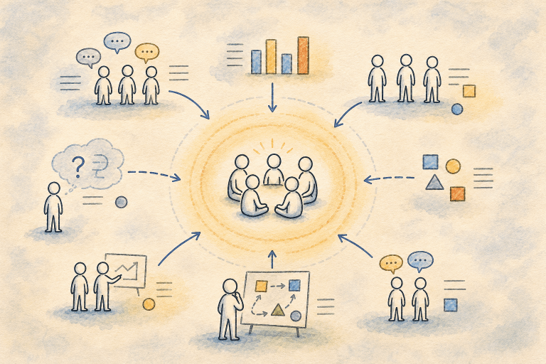

# What is Circle3?

*Circle3™ offers three guiding moves for leading difficult change by building shared understanding at the human layer.*

Change begins in a small working center—formal or informal—where a few people are responsible for making it real in practice.

That center always exists in some form, even if it is not recognized.

## When things fragment

When that center is not aligned in what it sees, everything else fragments.

Priorities compete.  
Messages multiply.  
Attention disperses.  
Meaning breaks apart.

## How Circle3 works

Circle3 aligns attention to what is actually happening—not what is assumed.

Not theory.  
Not abstraction.  
Only what is unfolding.

## What shifts

Shared perception forms.  
Language starts to converge.  
Decisions begin to hold.  
Less needs to be re-explained.

## What becomes possible

- Others can recognize what is emerging more easily  
- They can decide when and how to engage  
- It becomes easier to support what is forming without breaking it apart  

## The Moves and Lenses

Circle3 works through three guiding Moves that help people build shared understanding and coordinate action. Complementary Leadership Lenses are reflective exercises that help facilitators notice what is happening when conversations become difficult or stuck.

The Moves guide action. The Lenses support perception.

👉 [Explore the moves](/moves/){: data-ga-event="learn_more" data-ga-label="method_to_moves"}

👉 [Explore the lenses](/lenses/){: data-ga-event="learn_more" data-ga-label="method_to_lenses"}

👉 [Download the Circle3 paper](/paper/){: data-ga-event="download" data-ga-label="method_to_paper"}

## Where this came from

Circle3 did not begin as a formal framework.

The moves and lenses emerged gradually through decades of work across organizations, communities, leadership, facilitation, conflict, personal hardship, and reflective practice.

👉 [Read the origin story](/origin/){: data-ga-event="learn_more" data-ga-label="method_to_origin"}
