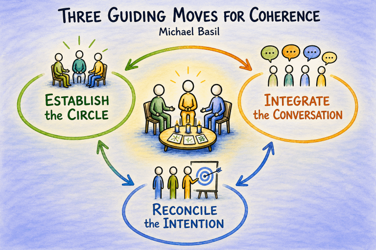

# Three Guiding Moves for Coherence

*Three moves for coordinating action in continuous change by* **Michael Basil**

*Three Guiding Moves™ help groups pause, make sense together, and act in alignment under changing conditions. Each works on its own. Together, they build coherence in action—creating clarity, alignment, and coordinated movement.*

*Circle3™ is not a linear process or sequence. Start where you are. Choose the move that fits your situation right now.*

## Establish the Circle

**When there is no stable nucleus of attention**

Bring together the people actively responsible for driving change.

Not the whole organization.

The change leaders.

This creates a shared space where attention can hold.

👉 [Learn more](/moves/establish/){: data-ga-event="learn_more" data-ga-label="moves_index_to_establish"}

## Integrate the Conversation

**When pressure or fatigue creates fragmentation**

Under pressure or fatigue, people respond differently.

Drivers push for movement.  
Organizers try to stabilize.  
Collaborators try to reconnect.  
Visionaries step back and reframe.

This move makes those tendencies visible.

It helps the group see how differently the situation is being experienced so the conversation can integrate instead of breaking apart.

👉 [Learn more](/moves/integrate/){: data-ga-event="learn_more" data-ga-label="moves_index_to_integrate"}

## Reconcile the Intention

**When clarity is forming but action is uneven**

Turn shared understanding into decisions that reflect what the group actually sees.

Not agreement for its own sake.

But commitments that hold.

👉 [Learn more](/moves/reconcile/){: data-ga-event="learn_more" data-ga-label="moves_index_to_reconcile"}
